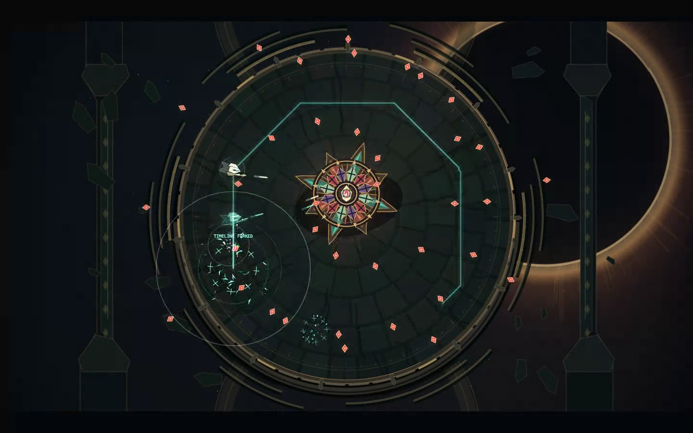

# ECHO REQUIEM

**Jump back. Leave yourself fighting.**

A temporal arena shooter inside a cathedral orbiting a dying sun. Fight through three escalating movements, choose forbidden upgrades, and silence **THE CHOIR**. Your strongest ally is the version of you that was here four seconds ago.



[Watch 12 seconds of actual gameplay with procedural audio](media/gameplay.webm).

## Play locally

Requires Node.js 22 or newer. No installation or downloaded dependencies.

On macOS, double-click **Play.command** to launch the local game and open your browser. Or use the terminal:

```sh
npm run dev
```

Open **http://localhost:4173/echo.html** in a desktop browser. Click Play to unlock sound. Keyboard and mouse required.

| Control | Action |
| --- | --- |
| WASD | Move |
| Mouse / hold left click | Aim / shoot |
| Space / E / right click | Fork your timeline |
| Shift | Dash |
| Escape | Pause / resume |
| M | Mute |
| 1 / 2 / 3 | Choose an offered upgrade |
| R on results | Retry the same seed |

**Fork** returns you to the start of your recent movement trail and leaves an echo replaying your shots. Health and the battlefield continue forward. You need at least one second of history and one charge. Build a useful firing path, Fork out of danger, and fire from another angle.

Charges refill automatically; kills accelerate recharge. Echoes deal 60% of recorded weapon damage, or 90% with the echo upgrade. Dashing and Fork arrival briefly protect you from damage.

A normal run contains three one-minute acts, two untimed upgrade choices, and the boss. The first few seconds are deliberately gentle. Retry Same Seed repeats the encounter seed; New Run changes it. `?seed=12345` starts a specified seed.

## Validate and build

```sh
npm test
npm run check
npm run build
npm run dev -- --dir dist --port 4174
```

The release output in `dist/` is a standalone static site: HTML, native modules, CSS, and an SVG icon. It contains no tests, docs, dependencies, or development artifacts. Serve it over HTTP rather than opening `index.html` as a file. The included development server binds to localhost and serves only game files.

## Architecture

- **Simulation:** fixed 60Hz, seeded RNG, bounded combat entities, swept projectile collision, immutable temporal recordings.
- **Rendering:** procedural Canvas2D cathedral, eclipse, silhouettes, cached glow effects and particles; independent of simulation.
- **Audio:** procedural Web Audio score and effects, unlocked by a user gesture.
- **Shell:** DOM menus, pointer/keyboard input, pause/focus handling, local profile storage.
- **Tests:** Node's built-in runner; no package dependencies.

Gameplay does not use wall-clock time or unseeded randomness. Cosmetic effects do not consume simulation RNG. Dropped display frames never cause an unbounded simulation catch-up. Losing focus pauses play and clears held controls.

Only sound/motion settings, best score, and last seed are stored locally. There are no campaign saves, accounts, telemetry, external assets, or network services. Unknown profile versions remain untouched. Future profile changes require a migration and fixture update.

## Accessibility and limits

Reduced Motion disables shake and intense flashes. Mute is available before and during play. Menus use real buttons and upgrade choices support number keys. This release targets desktop keyboard/mouse; touch controls, multiplayer, and cloud saves are out of scope.

See `docs/VALIDATION.md` for actual verification and `docs/CLAUDE_HANDOFF.md` for implementation notes and follow-up work.

Private project. No license to redistribute is granted by this repository.
